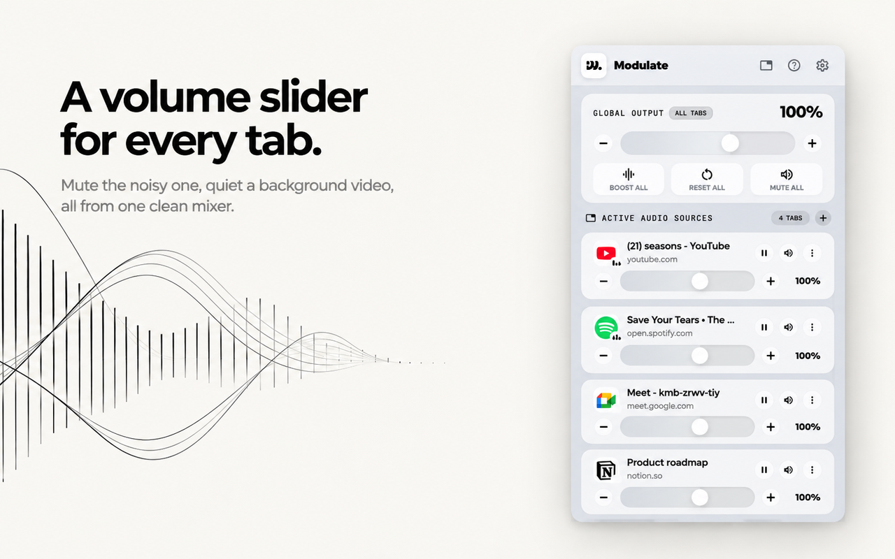
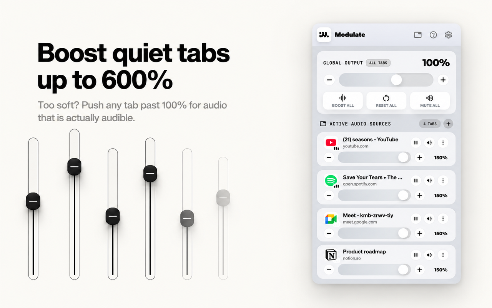
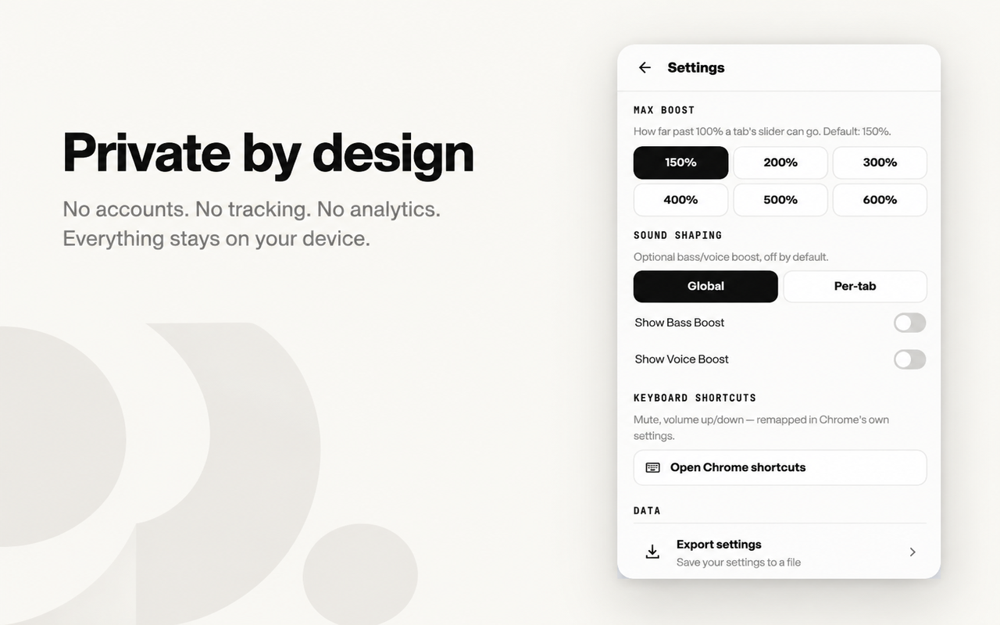

# Modulate: Tab Volume Mixer & Controller for Chrome

**Every tab, its own volume.** Mute one tab, boost another up to 600%, shape bass and voice, and control it all from the keyboard.

[**Add to Chrome, free**](https://chromewebstore.google.com/detail/modulate-tab-volume-mixer/fdogklkmofkicpciafkanncoaegepkmk) · [Website](https://modulate.top) · [How to use](https://modulate.top/how-to) · [Privacy](https://modulate.top/privacy) · [Support](https://modulate.top/support)

Modulate is a free **per-tab volume control** extension for Chrome and other Chromium browsers. Chrome gives you one volume for everything and only an on/off mute for a single tab. Modulate gives every tab that is playing audio its own slider, so you can turn a loud video down, keep your music steady, boost a quiet lecture, and mute one tab without touching the rest. It works with YouTube, Spotify on the web, Google Meet, Twitch, podcasts and any other site that plays sound.

> **About this repository.** This is the public home of Modulate: install links, screenshots, documentation and the public issue tracker. The extension's source code is not published here.

## Install

| Browser | How |
|---|---|
| Chrome | [Chrome Web Store](https://chromewebstore.google.com/detail/modulate-tab-volume-mixer/fdogklkmofkicpciafkanncoaegepkmk), then **Add to Chrome** |
| Brave, Edge, Vivaldi, Opera | Open the same Chrome Web Store link in that browser |
| Phones and tablets | Chrome extensions do not run on mobile browsers. Use the **Send link to my computer** button on [modulate.top](https://modulate.top) |

## What Modulate does

- **Per-tab volume sliders.** An independent volume for every tab that is playing audio, all at once.
- **Boost tab volume above 100%.** Raise a quiet tab with a Max boost you choose in Settings: 150, 200, 300, 400, 500 or 600%. The default ceiling is 150%.
- **Mute one tab.** Silence the loud tab and the rest keep playing. A muted tab turns red.
- **Audible tabs first.** Tabs that are playing sound float to the top of the mixer, so you can find the noisy one fast.
- **Global row.** Boost All, Reset All and Mute All for every tab in one tap.
- **Per-tab menu.** Reset a tab to 100%, close it, or remove it from the list.
- **Bass Boost and Voice Boost.** Optional sound shaping from -12 to +12 dB, for every tab at once or per tab. Hidden until you turn it on in Settings.
- **Keyboard shortcuts.** Mute and change volume without opening the popup.
- **Remembers your setting.** Each tab keeps its volume until you close that tab.
- **Pause from the mixer.** Pause a tab's media right from the popup.

## How to boost a quiet tab above 100%

1. Click the Modulate icon in the Chrome toolbar.
2. Open **Settings** and pick a **Max boost** (for example 300%).
3. Drag that tab's slider, or press **+**, past 100%.

## Keyboard shortcuts

| Action | Windows, Linux, ChromeOS | Mac |
|---|---|---|
| Mute or unmute the active tab | `Alt` + `Shift` + `M` | `Option` + `Shift` + `M` |
| Volume up 10% | `Alt` + `Shift` + `Up` | `Option` + `Shift` + `Up` |
| Volume down 10% | `Alt` + `Shift` + `Down` | `Option` + `Shift` + `Down` |

You can remap them at `chrome://extensions/shortcuts`.

## When it helps

- **Meetings and calls.** Turn a Google Meet tab up without making your music or a video louder.
- **YouTube and Spotify together.** Keep a video low and the music steady, from one popup.
- **Lectures and podcasts.** Boost a quiet recording past 100%.
- **Streaming and creating.** Balance several audio sources while you work.
- **Any noisy tab.** Find it, turn it down, or mute just that tab.

## Modulate, Chrome's own mute, and the Windows mixer

| | Chrome's built-in tab mute | Windows volume mixer | Modulate |
|---|---|---|---|
| Works per tab | Mute or unmute only | No, per application | **Yes, a slider per tab** |
| Volume above 100% | No | No | **Up to 600%** |

They work together: the Windows mixer sets the level for the whole browser, and Modulate sets the level inside it.

## Privacy

Modulate runs on your device. The extension collects no personal data, no browsing history and no analytics, and nothing about your tabs or your audio leaves your browser. It needs these permissions only for these reasons:

| Permission | Why |
|---|---|
| `tabs` | List tabs, their titles, icons and which are playing audio, so they appear in the mixer |
| `storage` | Remember each tab's volume and mute state while the tab is open |
| `scripting` and site access | Apply the chosen volume to the audio playing on each page. No page content is collected or sent |
| `contentSettings` | Clear Chrome's own "Mute site" block when you unmute a tab from the mixer, only on your explicit action |

Read the full [privacy policy](https://modulate.top/privacy). The website separately uses Google Analytics to count visits; the extension never talks to the website.

## Frequently asked questions

**Is Modulate free?** Yes. It is free to install from the Chrome Web Store and needs no account.

**Which browsers does it work in?** Chrome, Brave, Edge, Vivaldi and Opera. It is a desktop extension, so it does not run in mobile browsers.

**Does it remember my volume settings?** Each tab keeps its setting until you close that tab.

**Does Modulate collect my data?** The extension does not. See [Privacy](#privacy).

**How do I report a bug or suggest a feature?** [Open an issue](../../issues) here, or use the [support page](https://modulate.top/support). Describe the problem you are trying to solve, not only the control you want.

## Guides

- [Best Chrome extension to control volume per tab](https://modulate.top/blog/best-chrome-extension-tab-volume)
- [How to boost tab volume above 100% in Chrome](https://modulate.top/blog/boost-tab-volume-above-100)
- [How to mute one tab without muting your whole browser](https://modulate.top/blog/mute-one-tab-chrome)
- [How to control YouTube volume separately from other tabs](https://modulate.top/blog/youtube-volume-per-tab)
- [Chrome volume mixer vs Windows volume mixer](https://modulate.top/blog/chrome-vs-windows-volume-mixer)

## Rate Modulate

If Modulate helps, a short honest review on the [Chrome Web Store](https://chromewebstore.google.com/detail/modulate-tab-volume-mixer/fdogklkmofkicpciafkanncoaegepkmk/reviews) helps other people find it. Feedback of any kind is welcome.

## About

Modulate is built and maintained by a single independent developer. The extension is free to install. The source code is not published in this repository. Names, logos and images in `assets/` belong to Modulate.

**Topics:** chrome extension, per-tab volume control, tab volume mixer, volume booster, mute tab, bass boost, hotkeys, privacy, Manifest V3.
